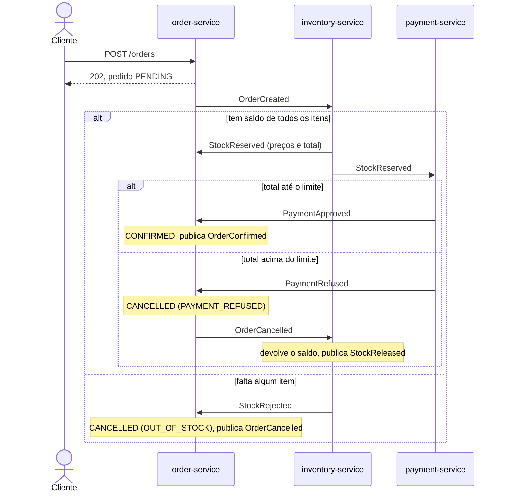

# order-platform

[](https://github.com/Jhonatas-de-Freitas/order-platform/actions/workflows/ci.yml)


Três serviços em Java que processam um pedido trocando eventos pelo Kafka: o `order-service` recebe o pedido, o `inventory-service` reserva o estoque e o `payment-service` cobra (de mentira). Cada um tem o seu banco PostgreSQL e nenhum chama o outro por HTTP. Não existe um serviço chefe: cada um reage ao evento do outro.

O que eu quis mostrar são os caminhos de falha: falta de estoque, pagamento recusado, serviço fora do ar, o mesmo evento chegando duas vezes ou fora de ordem, e uma mensagem que ninguém consegue ler.

Java 21, Spring Boot 4.1, Spring Kafka, Spring Data JPA, Flyway, PostgreSQL 17 e Kafka 4.2 (KRaft). Testes com JUnit, Testcontainers e Awaitility. Métricas com Micrometer, Prometheus e Grafana.

## Como funciona



Toda seta entre serviços passa pelo Kafka. Os eventos têm o mesmo envelope (`eventId`, `type`, `orderId`, `occurredAt`, `payload`) e a chave da mensagem é o `orderId`, então os eventos de um pedido ficam na mesma partição de cada tópico. Os tópicos são `orders.events`, `inventory.events` e `payments.events`. `OrderConfirmed` e `StockReleased` ninguém aqui ouve: servem para notificação e métricas.

Estados do pedido: `PENDING` → `STOCK_RESERVED` → `CONFIRMED`, ou `CANCELLED`. `CONFIRMED` e `CANCELLED` são finais: o que chegar depois é ignorado.

Cada serviço tem os pacotes `api` (REST e erros em `application/problem+json`), `domain` (regras, sem saber de Kafka), `messaging` (envelope, outbox, consumidor) e `persistence`. Os serviços não compartilham código: cada um tem a sua cópia do envelope e do outbox, para poderem mudar sem depender um do outro.

## Como rodar

Precisa de Docker.

```bash
docker compose up -d --build --wait
```

O Swagger de cada serviço fica em http://localhost:8081/swagger-ui.html, `8082` e `8083`. Prometheus em http://localhost:9090 e Grafana em http://localhost:3000 (abre direto no painel, sem login).

O painel do Grafana mostra pedidos por estado, tempo do pedido até o estado final, reservas, pagamentos, mensagens na fila de erros e eventos pendentes no outbox. Os contadores começam do zero quando o serviço reinicia, e `docker compose down` apaga tudo, bancos inclusive.

Testes de unidade e de integração (os de integração sobem PostgreSQL e Kafka com Testcontainers, então também precisam de Docker):

```bash
./mvnw verify
```

## Como testar os cenários

As respostas abaixo foram copiadas do job `e2e` do CI, com a stack recém-criada. Os ids mudam a cada pedido. Os `jq` só cortam campos para caber aqui.

Caminho feliz, dois teclados:

```bash
curl -i -X POST localhost:8081/orders -H 'Content-Type: application/json' -d '{
  "customerId":"c-1001","customerName":"Ana Souza","customerEmail":"ana@exemplo.com",
  "items":[{"productId":"11111111-1111-1111-1111-111111111111","quantity":2}]}'
```

Responde `HTTP/1.1 202` com `Location: /orders/180708fa-e599-4655-a2a3-726f464a5c60` e o pedido completo em `PENDING`, ainda sem nomes e preços (`"totalAmount":null`).

Dois segundos depois o pedido está confirmado, pago, e o saldo do teclado caiu de 50 para 48:

```bash
ORDER=180708fa-e599-4655-a2a3-726f464a5c60
curl -s localhost:8081/orders/$ORDER | jq -c '{status, totalAmount, history: [.history[] | .status + ": " + .detail]}'
curl -s localhost:8083/payments/$ORDER | jq -c '{status, amount}'
curl -s localhost:8082/products/11111111-1111-1111-1111-111111111111 | jq -c '{name, availableQuantity}'
```
```
{"status":"CONFIRMED","totalAmount":699.80,"history":["PENDING: Pedido recebido","STOCK_RESERVED: Estoque reservado","CONFIRMED: Pagamento aprovado"]}
{"status":"APPROVED","amount":699.80}
{"name":"Teclado Mecânico","availableQuantity":48}
```

`curl -N localhost:8081/orders/stream`, aberto antes do pedido, recebe um evento por mudança (este é o primeiro; vieram mais dois, com `STOCK_RESERVED` e `CONFIRMED`) e um comentário de keep-alive a cada 15 s:

```
event:order-updated
data:{"id":"180708fa-e599-4655-a2a3-726f464a5c60","customerId":"c-1001","customerName":"Ana Souza","status":"PENDING","totalAmount":null,"itemCount":1,"createdAt":"2026-10-10T20:39:46.058Z","updatedAt":"2026-10-10T20:39:46.058Z"}
```

Para os próximos, uma função que faz o mesmo `POST` com os itens dados e devolve o id:

```bash
order() { curl -s -X POST localhost:8081/orders -H 'Content-Type: application/json' -d '{"customerId":"c-1001",
  "customerName":"Ana Souza","customerEmail":"ana@exemplo.com","items":['"$1"']}' | jq -r .id; }
```

Sem estoque, um Headset (saldo 0): cancelado, e nenhum pagamento foi criado.

```bash
ORDER=$(order '{"productId":"44444444-4444-4444-4444-444444444444","quantity":1}')
curl -s localhost:8081/orders/$ORDER | jq -c '{status, cancellationReason, cancellationDetail}'
curl -s localhost:8083/payments/$ORDER
```
```
{"status":"CANCELLED","cancellationReason":"OUT_OF_STOCK","cancellationDetail":"44444444-4444-4444-4444-444444444444: pedido 1, disponível 0"}
{"type":"about:blank","title":"Not Found","status":404,"detail":"Payment for order 7af69585-89c4-4f60-9f04-3dff3c7bf675 not found","instance":"/payments/7af69585-89c4-4f60-9f04-3dff3c7bf675"}
```

Pagamento recusado, um Notebook (7499.00, acima do limite de 5000.00): o estoque chegou a reservar, o pagamento foi recusado, o pedido cancelou e a reserva foi devolvida.

```bash
ORDER=$(order '{"productId":"55555555-5555-5555-5555-555555555555","quantity":1}')
curl -s localhost:8081/orders/$ORDER | jq -c '{status, totalAmount, cancellationReason, cancellationDetail}'
curl -s localhost:8083/payments/$ORDER | jq -c '{status, amount, reason}'
curl -s localhost:8082/reservations/$ORDER | jq -c '{status, releasedAt}'
curl -s localhost:8082/products/55555555-5555-5555-5555-555555555555 | jq -c '{name, availableQuantity}'
```
```
{"status":"CANCELLED","totalAmount":7499.00,"cancellationReason":"PAYMENT_REFUSED","cancellationDetail":"Pagamento recusado: LIMIT_EXCEEDED"}
{"status":"REFUSED","amount":7499.00,"reason":"LIMIT_EXCEEDED"}
{"status":"RELEASED","releasedAt":"2026-10-10T20:39:59.613Z"}
{"name":"Notebook Pro 16","availableQuantity":10}
```

Tudo ou nada, um Mouse e um Headset no mesmo pedido: o Headset não tem saldo, então nem o Mouse foi reservado.

```bash
ORDER=$(order '{"productId":"22222222-2222-2222-2222-222222222222","quantity":1},
  {"productId":"44444444-4444-4444-4444-444444444444","quantity":1}')
curl -s localhost:8081/orders/$ORDER | jq -c '{status, cancellationReason}'
curl -s localhost:8082/products/22222222-2222-2222-2222-222222222222 | jq -c '{name, availableQuantity}'
```
```
{"status":"CANCELLED","cancellationReason":"OUT_OF_STOCK"}
{"name":"Mouse Sem Fio","availableQuantity":80}
```

Pedido inválido:

```bash
curl -i -X POST localhost:8081/orders -H 'Content-Type: application/json' -d '{"customerId":"","customerName":"Ana Souza",
  "customerEmail":"ana","items":[{"productId":"11111111-1111-1111-1111-111111111111","quantity":0}]}'
```
```
HTTP/1.1 400
Content-Type: application/problem+json

{"type":"about:blank","title":"Bad Request","status":400,"detail":"The request has invalid fields","instance":"/orders","errors":[{"field":"customerId","message":"must not be blank"},{"field":"customerEmail","message":"must be a well-formed email address"},{"field":"items[0].quantity","message":"must be greater than or equal to 1"}]}
```

Último item: o smoke test cria um produto com saldo 1 (`POST /products`) e manda dois pedidos dele ao mesmo tempo. Um chega a `CONFIRMED`, o outro a `CANCELLED` com `OUT_OF_STOCK`, e o saldo termina em 0.

Serviço fora do ar: com `docker compose stop payment-service`, um pedido de Mouse para em `STOCK_RESERVED` (o `StockReserved` fica esperando no tópico). Depois de `docker compose start payment-service` ele chega a `CONFIRMED` assim que o serviço sobe e lê o tópico.

Mensagem inválida: `./scripts/dead-letter-demo.sh` publica um texto que não é JSON em `orders.events`, mostra onde ele foi parar e confere que o pedido seguinte passa. Trecho da saída no CI:

```
== Waiting for it in inventory-service.dlt
    demo-1791665544 | isto nao e um evento
    kafka_dlt-exception-message:Not a valid event: Unrecognized token 'isto': was expecting (JSON String, ...)
    kafka_dlt-original-topic:orders.events
== The next order still goes through
  order 5903850d-d656-459e-98f2-3b733eca7a9f is CONFIRMED
```

Todos esses cenários, com as conferências, estão em `./scripts/smoke-test.sh` (precisa de `curl` e `jq`), e `./scripts/check-metrics.sh` confere que o Prometheus raspa os três serviços e que cada consulta do painel do Grafana tem dados. O CI roda os três scripts a cada push.

## Decisões que tomei e por quê

**Outbox.** O serviço grava a mudança e o evento na mesma transação, numa tabela `outbox`. Um publicador separado lê a tabela a cada 500 ms com `FOR UPDATE SKIP LOCKED` (duas instâncias não pegam a mesma linha), envia o lote, espera o broker confirmar e só então marca como publicado. Com o Kafka fora, o pedido continua sendo aceito e o evento sai quando o broker volta: tem um teste que pausa o container do Kafka no meio. O preço é a entrega "pelo menos uma vez": o mesmo evento pode sair duas vezes, sempre com o mesmo `eventId`.

**Idempotência.** Por isso cada consumidor grava o `eventId` em `processed_events` (`insert ... on conflict do nothing`) na mesma transação do efeito. Se já existia, descarta. Se o efeito falha, a marca é desfeita junto e a nova tentativa começa limpa. E ainda há uma reserva e um pagamento por pedido (`order_id` único), para o caso de um evento repetido com outro id.

**Coreografia em vez de orquestração.** Nenhum serviço conhece o fluxo inteiro, cada um reage ao evento do outro. Com três passos fica simples, e um serviço fora do ar só atrasa o pedido, não perde nada. O custo é que o fluxo não está escrito em um lugar só: por isso o diagrama e o smoke test. Com mais passos ou regras de prazo, eu passaria a um orquestrador.

**Evento fora de ordem.** `StockReserved` e `PaymentApproved` vêm de tópicos diferentes, então o pagamento pode chegar primeiro no `order-service`. Não usei retry para isso: travaria a partição e dependeria de tempo, podendo terminar na fila de erros. `PaymentApproved` com o pedido ainda em `PENDING` só liga uma marca; quando o `StockReserved` chega, o pedido passa por `STOCK_RESERVED` e vai para `CONFIRMED` na mesma transação. `PaymentRefused` em `PENDING` cancela na hora, e o `OrderCancelled` faz o estoque devolver a reserva. O pedido é lido com trava de linha, porque os dois tópicos chegam ao mesmo tempo.

**Tudo ou nada.** O `inventory-service` olha o pedido inteiro antes de tirar qualquer saldo. Os produtos são lidos com `select ... for update`, sempre em ordem de id: dois pedidos no mesmo produto esperam um pelo outro, e a ordem fixa evita deadlock entre pedidos com os mesmos produtos em ordem diferente. Um `check (available_quantity >= 0)` no banco é a rede de segurança. O consumidor do estoque usa 3 threads de propósito, para a trava trabalhar também pelo caminho do Kafka, e um teste dispara pedidos simultâneos pelo último item.

**Retry e fila de erros.** Uma falha ao consumir é tentada 4 vezes (200, 400 e 800 ms entre elas) e depois vai para `<serviço>.dlt`, com o motivo nos headers e a mensagem original intacta. Mensagem que não é JSON, ou que não é um evento válido, vai direto, sem retry, e a partição continua andando.

## O que eu faria a seguir

- Prazo para o pedido: se o `payment-service` nunca responder, o pedido fica em `STOCK_RESERVED` para sempre. Um job que cancela pedidos parados há alguns minutos resolve, e o estoque volta pelo mesmo `OrderCancelled`.
- Um jeito de reprocessar a fila de erros depois de corrigir a causa.
- Limpar as linhas antigas de `outbox` e `processed_events`, que hoje só crescem.
- Tracing com OpenTelemetry, levando o trace no header da mensagem, para seguir um pedido pelos três serviços.
- Readiness olhando o Kafka (hoje só o banco) e esquema dos eventos versionado, com teste de contrato entre os serviços.
